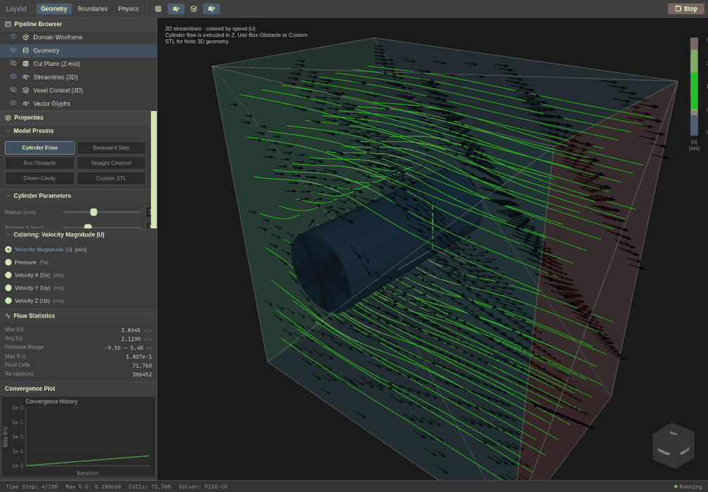

# LiqVid

[](https://github.com/goatnath/LiqVid/actions/workflows/rust.yml)

A lightweight 3D computational fluid dynamics project written from scratch in Rust, paired with a ParaView-inspired React/Three.js frontend. It solves the incompressible Navier–Stokes equations on a structured Cartesian grid using a simplified pressure-projection (PISO-style) method, inspired by OpenFOAM's `icoFoam`.

This is a learning project. Operator and integration tests cover selected numerical behaviors, but a quantitative comparison against a reference CFD benchmark is still outstanding.




Actual simulation captures; the animation shows successive instantaneous fields, not particle pathlines. [Capture settings](docs/media/README.md).

## What it does

- **Structured 3D mesh:** 50 × 50 × 30 cells (75,000 total) over a fixed 100 × 100 × 60 domain, with flat arrays for velocity and pressure.
- **Momentum predictor:** explicit viscous diffusion and first-order upwind convection.
- **Pressure projection:** a matrix-free Conjugate Gradient (CG) pressure solve reduces velocity divergence. Solid cells are excluded from the pressure solve.
- **Six-face boundary editor:** configure Inlet, Outlet, No-Slip, Slip, or Moving Wall conditions in the Properties panel. Boundary values apply at faces, including faces meeting at edges and corners.
- **Geometry:** built-in presets and STL voxelization using Möller–Trumbore ray casting. The `stl_io` parser accepts binary and ASCII STL files; solid faces impose no-slip velocity.
- **Live visualization:** Server-Sent Events stream snapshots into a dark scientific UI with a pipeline browser, orientation viewcube, colorbar, statistics, and divergence history.
- **3D flow views:** speed-colored RK4 streamlines and directional arrow glyphs are enabled by default. An optional low-opacity voxel layer renders the complete received cell list.
- **Cut plane:** an optional fixed Z-mid texture displays velocity magnitude or pressure. Individual velocity components appear in the selector but are not yet implemented.

See [flow visualization](docs/flow-visualization.md) for layer controls and [the simulation API](docs/simulation-api.md) for the request format, units, and domain coordinates.

## Getting started

### Prerequisites

- **Rust:** current stable toolchain with edition 2024 support. Edition 2024 starts at Rust 1.85; the dependency set is checked with current stable in CI.
- **Node.js:** 20.19+ on the Node 20 line, or 22.12+ on newer lines, as required by the installed Vite toolchain.
- A browser with WebGL support.

Use two terminals.

**Terminal 1 — Rust backend:**

```bash
git clone https://github.com/goatnath/LiqVid.git
cd LiqVid
cargo run --release
```

The server listens on `http://127.0.0.1:3000`. Release mode is recommended for interactive simulations.

**Terminal 2 — React frontend:**

```bash
cd LiqVid/ui
npm ci
npm run dev
```

Open the local Vite URL, usually `http://localhost:5173`. Select a preset in **Geometry**, configure each face in **Boundaries**, adjust viscosity and density in **Physics**, then click **Run**. Use **Stop** to disconnect the stream and stop the simulation worker. The pipeline eye icons and toolbar buttons toggle each visualization layer.

### Presets

| Preset | API type | Geometry and setup |
|--------|----------|--------------------|
| Cylinder Flow | `channel_cylinder` | Cylinder spanning Z, with editable radius and XY position; channel inflow/outflow |
| Backward Step | `step` | Step anchored at the origin and spanning Z; channel inflow/outflow |
| Box Obstacle | `box_obstacle` | Finite obstacle with editable bounds in all three axes; check face conditions before running |
| Driven Cavity | `cavity` | Empty domain with a moving top wall, stationary side/bottom walls, and slip Z faces |
| Straight Channel | `box` | Empty domain with channel inflow/outflow |
| Custom STL | `stl` | Uploaded solid geometry; check face conditions before running |

The box obstacle and STL selections retain the current face settings. Cylinder, step, straight-channel, and cavity presets set their own boundary defaults. For an STL channel case, select Straight Channel first, then upload the STL.

Cylinder and step geometry is extruded in Z, so uniform inflow with slip Z faces can give nearly identical Z slices. Use a finite box obstacle or STL to explore variation across all three axes. STL geometry should be closed, watertight, and placed within solver coordinates X/Y = 0–100 and Z = 0–60; the viewport shifts these coordinates to center the domain.

## Architecture

| Location | Responsibility |
|----------|----------------|
| `src/main.rs` | Axum `/simulate` endpoint, Tokio runtime, simulation worker, and bounded SSE streaming |
| `src/config.rs` | Request validation, geometry presets, and face boundary mapping |
| `src/piso.rs` | Momentum prediction, pressure CG solve, and velocity correction |
| `src/fvc.rs` | Gradient, divergence, velocity Laplacian, and convection operators |
| `src/fields.rs`, `src/mesh.rs` | Field storage, boundary types, and uniform mesh indexing |
| `src/geometry.rs` | STL loading and voxel classification |
| `src/visualization.rs` | Block-averaged velocity grid and conservative obstacle mask for streamlines |
| `src/benchmark.rs` | Ghia et al. Re=100 reference table and comparison helper; not yet wired into a benchmark runner or the binary module tree |
| `ui/` | React 19, React Three Fiber, Three.js, Vite, and visualization tests |
| `openfoam/` | Standalone OpenFOAM mesh-generation starter case |

### OpenFOAM interoperability

The [OpenFOAM starter case](openfoam/README.md) provides `blockMesh` and `snappyHexMesh` dictionaries for generating a body-fitted mesh around an STL. It is a separate workflow: the Rust solver still uses its own structured voxel grid and does not import OpenFOAM `polyMesh` output.

## Tests and validation

```bash
# From the repository root
cargo test

# From ui/
npm test
npm run lint
npm run build
```

The current suite has 11 Rust tests and 5 frontend numerical tests. Rust checks include preset voxelization, request validation, face mapping, gradient and diffusion behavior, solid exclusion, Poisson convergence for a manufactured linear field, density scaling, and streamed frame contents. Frontend tests cover interpolation, an analytic 3D helix, obstacle/stagnation stopping, and inlet seeding. CI runs both test suites and the frontend lint/build.

These tests do not validate a steady cavity solution against Ghia et al. The reference table's helper tests are currently outside the compiled module tree. Completing a 100-step UI run also does not establish steady-state convergence.

For constant density, the solver stores physical pressure: ∇²p = (ρ/Δt)∇·u* and u = u* − (Δt/ρ)∇p. At fixed kinematic viscosity and velocity boundaries, changing density scales pressure while preserving velocity; a regression test checks this behavior. Closed-domain pressure has an arbitrary additive constant.

## Current limits and roadmap

The grid, domain, timestep (0.1), step count (100), and pressure iteration cap (100) are fixed. Numerical cell loops are serial, and CG has no preconditioner. The collocated projection needs quantitative conservation and accuracy validation; it does not guarantee exactly zero discrete divergence.

Streamlines are instantaneous curves recomputed from each snapshot, rather than time-dependent particle pathlines. The conservative coarse obstacle mask can terminate them before the visible surface. The cut plane is fixed at Z-mid. There is no volume raymarching, isosurface extraction, adaptive mesh, or OpenFOAM mesh importer.

- [x] Matrix-free CG pressure solve with solid exclusion
- [x] Six-face boundary configuration connected to the solver
- [x] ParaView-inspired layer browser, cut plane, statistics, and divergence plot
- [x] Complete voxel instance rendering, low-opacity context, and default arrows
- [x] 3D RK4 streamlines with obstacle-aware interpolation
- [x] Numerical regression tests and CI test steps
- [ ] Automated Re=100 lid-driven cavity run and reference comparison plot
- [x] README screenshot and animation captured from a real simulation
- [ ] Interactive cut-plane position/orientation and velocity-component coloring
- [ ] Jacobi-preconditioned CG and parallel cell loops
- [ ] Configurable mesh resolution, domain dimensions, and run controls
- [ ] Time-dependent particle pathlines and additional volumetric views

See the [prioritized roadmap](docs/roadmap.md) for the remaining work and acceptance checks.

## Why I built this

I wanted to learn the mathematics and architecture of CFD by implementing the numerical building blocks myself. Writing the momentum predictor, boundary operators, and pressure correction makes the assumptions and limitations of the method visible.

## License

[MIT](LICENSE)
