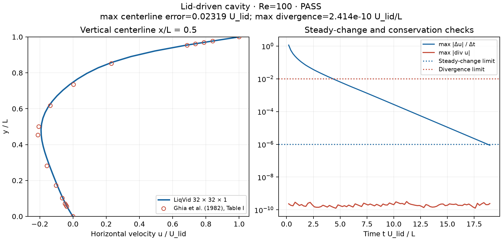
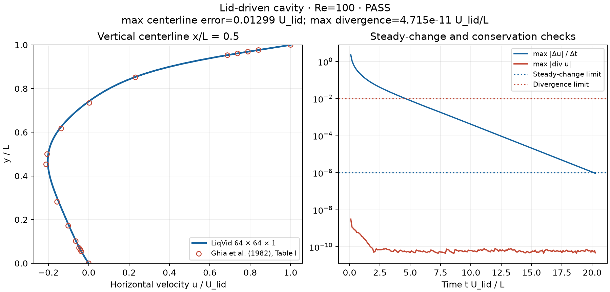

# Re=100 lid-driven cavity benchmark

This runner measures the existing solver; it does not replace it with a separate
cavity implementation. The shared core now uses a compatible pressure operator.
Both the web API and `examples/cavity.rs` call `piso::advance` through the shared
`liqvid` library. The benchmark uses the cavity preset's actual boundary mapping at a normalized scale.

The reference is the horizontal velocity u/U along x/L=0.5 from **Table I,
Re=100**, in [Ghia, Ghia & Shin (1982), *High-Re solutions for incompressible flow
using the Navier–Stokes equations and a multigrid method*](https://doi.org/10.1016/0021-9991(82)90058-4).
The 17 values are stored in `src/benchmark.rs` and now compiled into the library
and tests. For context, [NETL's MFiX cavity verification
case](https://mfix.netl.doe.gov/doc/vvuq-manual/main/html/fluid/fld-03.html) also
uses this reference and the U=L=ρ=1, ν=0.01 Re=100 setup.

## Reproduce

From the repository root:

```bash
# Numerical results only; no Python dependency
cargo run --release --example cavity

# Numerical run plus JSON, CSV, PNG, SVG, and text report
python3 -m pip install -r scripts/requirements-validation.txt
python3 scripts/validate_cavity.py

# Refined run
python3 scripts/validate_cavity.py --n 64 --dt 0.001 --output docs/validation/cavity-re100-64

# Render existing results without rerunning the solver
python3 scripts/validate_cavity.py --plot-only

# Strict check: produces artifacts first, then exits 2 on any failed criterion
python3 scripts/validate_cavity.py --check
```

Rust also accepts `--n`, `--dt`, `--max-steps`, `--output`, and `--check`. Use
`cargo run --release --example cavity -- --help` for the command syntax. The
Python wrapper accepts the same settings plus `--plot-only`. Numerical
instability, invalid arguments, or plotting errors return a nonzero exit code.
In ordinary report mode, an overall numerical FAIL is saved and displayed but
does not prevent plot generation. Use `--check` to make that status gate a run.

## Setup and acceptance criteria

- Square cavity: Lx=Ly=1, lid speed U=1 in +X, ν=0.01, uniform density ρ=1;
  Re=UL/ν=100.
- Stationary no-slip X walls and Y-min wall; moving Y-max lid. Conditions act on
  boundary faces, not by overwriting shared corner cell velocities.
- One homogeneous Z cell with slip Z faces and Lz=1/N. This reproduces the 2D
  reference case using the 3D core; it is not a finite-depth cavity with no-slip
  front/back walls.
- Initially zero velocity and pressure. All pressure faces are zero-gradient;
  subtract the spatial mean pressure after every step to fix its arbitrary gauge.
- Use explicit diffusion/upwind convection and a compatible collocated pressure
  projection: solve D(G(p)) = (ρ/Δt)D(u*) using the same `fvc::div` and `fvc::grad`
  as the velocity correction. CG retains its 100-iteration cap and absolute L2
  tolerance 1e-6. Correction boundary data are homogeneous: prescribed velocity
  faces keep their flux, while pressure outlets extrapolate the correction.
- Default: N=32, Δt=0.002, maximum 30,000 steps. Refined: N=64, Δt=0.001.
- Steady-change criterion: max over all cells and components of |Δu|/Δt < 1e-6
  for 100 consecutive steps. This prevents a small timestep alone from satisfying
  a raw change criterion. It does not imply a divergence-free solution.
- Reference criterion: maximum absolute u/U error at all 17 published coordinates
  ≤ 0.05. Also report RMS error over those same 17 samples, including endpoints.
- Conservation criterion: full-domain maximum |div u| ≤ 0.01 in units U/L,
  using the same `fvc::div` as the web API, including boundary-adjacent cells.
- The three limits are practical thresholds chosen for this harness, not
  tolerances prescribed by Ghia et al. Overall PASS requires **all three**.

On an even grid, x/L=0.5 lies between columns. Average the two adjacent columns,
then linearly interpolate the computed profile in Y to each published Ghia
coordinate. Include the known bottom/lid boundary values (0,0) and (1,1).
The implementation does not interpolate a sparse reference curve onto solver
nodes to compute its reported maximum error.

## Measured results

| Grid | Δt | Steps | Final time | Max change rate | Max centerline error | RMS error | Max divergence | Overall |
|------|----|-------|------------|-----------------|----------------------|-----------|----------------|---------|
| 32 × 32 × 1 | 0.002 | 9,480 | 18.960 | 8.811e-07 | 0.02319450 | 0.01087333 | 2.414e-10 | **PASS** |
| 64 × 64 × 1 | 0.001 | 20,253 | 20.253 | 9.414e-07 | 0.01299489 | 0.00518392 | 4.715e-11 | **PASS** |

Both reach the specified steady-change criterion and pass the centerline and
full-domain discrete divergence limits. These two runs do not establish an
asymptotic spatial convergence order or validate arbitrary geometries and flows.

The previous compact Poisson stencil differed from D(G(p)), the operator formed
by applying the measured divergence to the actual pressure-gradient correction.
Consequently a converged pressure solve left maximum divergence of 1.52890691
on the default grid and 4.24471667 on the refined grid. The shared solver now
applies D(G(p)) directly, with homogeneous correction boundary data and solid
exclusion. Thus the corrected divergence is the scaled pressure residual, up to
roundoff, rather than the mismatch between two different discrete operators.
This does not remove the iteration cap, incompatible prescribed-flux constraints,
or possible collocated pressure null modes. A two-pressure-outlet regression
checks the recovered physical gradient because pressure itself can contain a
checkerboard null mode; this change does not claim unique pressure in that case.

### Default 32 × 32 run



[Raw JSON](cavity-re100/results.json) · [sample CSV](cavity-re100/comparison.csv) ·
[SVG](cavity-re100/comparison.svg) · [text summary](cavity-re100/summary.txt)

### Refined 64 × 64 run



[Raw JSON](cavity-re100-64/results.json) · [sample CSV](cavity-re100-64/comparison.csv) ·
[SVG](cavity-re100-64/comparison.svg) · [text summary](cavity-re100-64/summary.txt)

## Automation

The [cavity report workflow](../../.github/workflows/cavity-benchmark.yml) runs the
32 × 32 case on relevant pushes/PRs and on manual dispatch, and uploads its report
artifacts. A successful report-mode workflow means that execution and artifact
generation succeeded, **not** that the numerical validation passed. The actual
criteria appear in `results.json`, plot titles, and the job summary. Manual
workflow dispatch offers an `enforce` input to fail the job on any missed criterion.
The documented runs pass that strict check.

The unit suite separately checks reference values, interpolation, coverage and
nonfinite-data rejection, plus the existing core/API regression tests. The
benchmark is longer-running and is not hidden inside `cargo test`.
